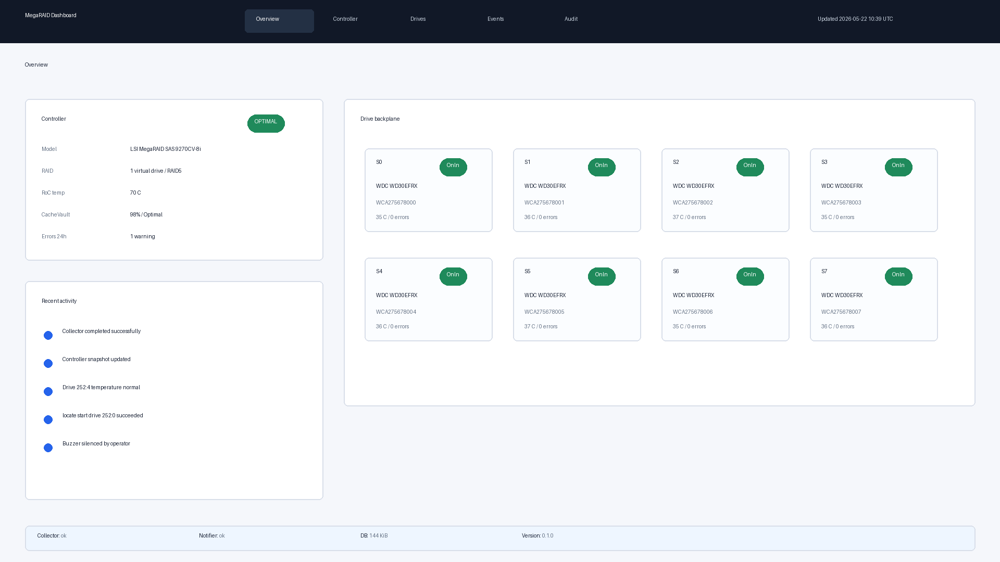
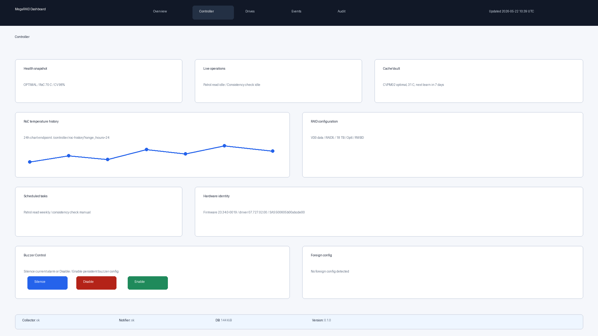
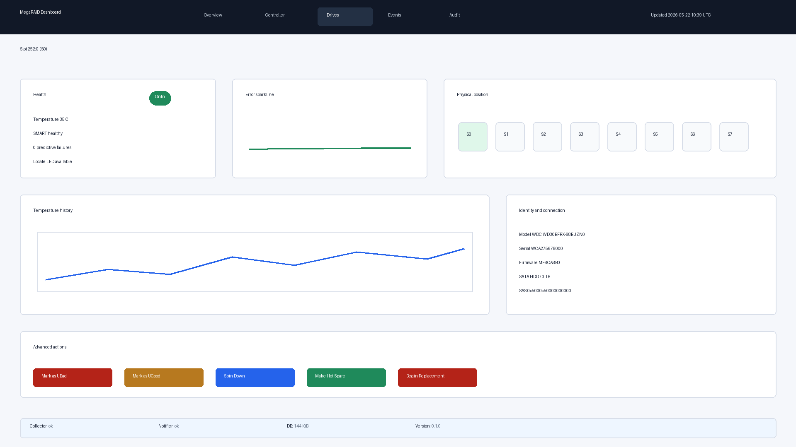
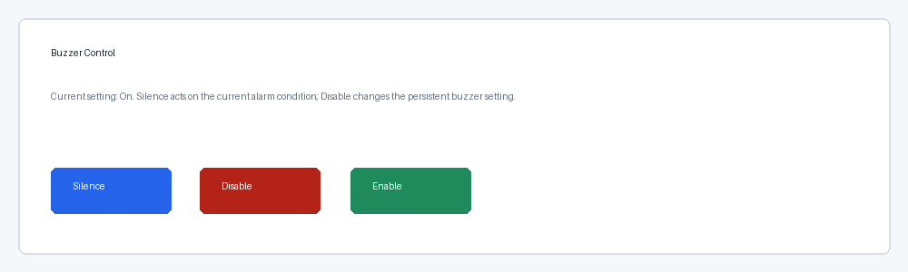

# MegaRAID Dashboard

[](LICENSE)
[](https://github.com/AlexBomber12/megaraid-dashboard/actions/workflows/ci.yml)
[](https://github.com/AlexBomber12/megaraid-dashboard/releases/latest)

MegaRAID Dashboard is a web dashboard and email alerter for LSI MegaRAID controllers, JSON-driven via `storcli`, intended as a sustainable replacement for the unmaintained MegaRAID Storage Manager (MSM).

## Why

MSM has been unmaintained since 2018 and is broken on modern Linux kernels. `storcli` is supported by Broadcom and is stable across kernel and OS upgrades.

## Hardware Tested

- LSI MegaRAID SAS 9270CV-8i (chip SAS 2208)
- Ubuntu 24.04
- Kernel 6.8
- `megaraid_sas` driver

## Requirements

- Python 3.12
- `storcli64` in `PATH`
- MegaRAID controller accessible to the host
- `sudo` with a whitelist of `storcli` commands when write operations are enabled

## Quick Start

```bash
python3 -m venv .venv
source .venv/bin/activate
pip install -e ".[dev]"
python -m megaraid_dashboard
```

The local development UI is served at <http://127.0.0.1:8090/>.

## Dashboard Overview

The redesigned dashboard is organized around the normal operator path: start with the main
page, drill into controller health when the controller needs attention, and drill into a
single drive when a slot needs action.









## Quick Tour

1. Open `/` for the main dashboard. The first viewport shows one controller card, an
   eight-drive backplane grid, the latest activity timeline, and the system status bar.
   The page refreshes through HTMX every 30 seconds, so it can lag real controller state by
   up to one polling interval.
2. Open `/controller` from the navigation or the controller card when controller-level
   details matter. The page includes health, live operation status, CacheVault, RAID
   configuration, scheduled tasks, hardware identity, foreign config status, buzzer control,
   and the RoC temperature history chart. The RoC chart reads JSON from
   `/controller/roc-history?range_hours=24`; supported ranges are `1`, `24`, `168`, and
   `720` hours.
3. Open a drive detail page from a grid tile, for example `/drives/252:0`. The page shows
   the selected slot, a backplane position diagram, identity and connection fields, an error
   sparkline, a fixed-height temperature history chart, locate controls, replacement entry,
   and advanced drive actions. The backplane diagram is logical; physical bay order may need
   per-deployment mapping before it exactly matches a chassis.

### Buzzer Control

The controller page exposes three buzzer actions while maintenance mode is enabled:

- `Silence` runs `/c0 set alarm=silence`. It acts on the current audible condition without
  changing the persistent buzzer setting. The dashboard cannot infer from a stored snapshot
  whether the buzzer is actively sounding, so use this when the physical alarm is audible.
- `Disable` runs `/c0 set alarm=off`. It changes the persistent controller buzzer
  configuration and should be used only when the operator intentionally wants no physical
  alarm.
- `Enable` runs `/c0 set alarm=on` to restore the persistent physical alarm setting.

All buzzer POST routes are CSRF-protected, require maintenance mode, and write an operator
audit event.

### Advanced Drive Actions

The drive detail page includes advanced operations for maintenance workflows:

- `Mark as UBad` is valid only when the latest live drive state is `UGood`.
- `Mark as UGood` is valid only when the latest live drive state is `UBad`.
- `Spin Down` is valid for `Onln`, `UGood`, or `UBad` drives.
- `Make Hot Spare` is valid for a `UGood` drive and requires a real disk group id.

The route layer validates the persisted snapshot first, rechecks live drive state through
`storcli`, requires maintenance mode, and records the result in the operator audit trail.

## Development

```bash
ruff check .
ruff format .
mypy src
pytest
```

Coverage policy: 100% line + 100% branch on `src/megaraid_dashboard/`. CI fails below.

Pre-commit is optional: `pip install pre-commit && pre-commit install`. Hooks run on
`git commit`; CI remains the canonical validation gate.

### End-to-end tests (Playwright)

E2E tests live under `tests/e2e/`. They run the app in-process and exercise
real HTTP requests via Playwright. The default `pytest` invocation skips them
(`--ignore=tests/e2e`) so contributors do not need a browser installed for the
unit-test loop. To run them locally:

```
pip install -e ".[dev]"
playwright install --with-deps chromium
pytest -o "addopts=" tests/e2e/ --browser chromium --no-cov
```

E2E tests are excluded from the unit-test coverage gate. The `--no-cov` flag
disables coverage collection for the e2e-only run so the global
`--cov-fail-under=100` gate (which only measures `src/megaraid_dashboard/`)
does not fail when the e2e suite does not exercise the full source tree.
The `-o "addopts="` flag clears the `addopts` from `pyproject.toml` (which
contains `--ignore=tests/e2e` to keep e2e out of the default unit-test run)
so the explicit e2e invocation collects the suite regardless of pytest's
path-vs-`--ignore` precedence rules.

The e2e suite also runs in CI as a separate job after the main test suite
passes. PRs that touch the web layer or templates must pass both gates.

## Documentation

- Install - production installer notes; forthcoming.
- [Runbook](docs/RUNBOOK.md) - routine operations, incidents, recovery, backups, and upgrades.
- [Architecture](docs/ARCHITECTURE.md) - high-level data flow, components, schema, and state.
- [Troubleshooting](TROUBLESHOOTING.md) - symptom-to-cause diagnostic reference.
- [Proxy setup](docs/PROXY-SETUP.md) - nginx reverse proxy, TLS, and `/raid/` path prefix.
- [Threat model](docs/THREAT-MODEL.md) - assets, trust boundaries, actors, and STRIDE review.
- [Security audit](docs/SECURITY-AUDIT-2026-Q2.md) - quarterly pass-1 audit checklist,
  findings, and remediation plan.
- [Security penetration pass](docs/SECURITY-AUDIT-2026-Q2-pen.md) - quarterly pass-2 curl
  test cases for auth, CSRF, rate limiting, command injection, SQL injection, XSS, path
  traversal, and audit-log forgery. Run `scripts/security-scan.sh` during each quarterly
  review.

## Cross-References

- [homelab-monitoring](https://github.com/AlexBomber12/homelab-monitoring) - shared
  Prometheus and Grafana stack for MegaRAID Dashboard metrics and future homelab services.

## Community

- [Contributing](CONTRIBUTING.md) - development setup, style, testing, and PR workflow.
- [Code of Conduct](CODE_OF_CONDUCT.md) - community standards and enforcement process.

## Database

SQLite stores controller, virtual drive, physical drive, and cache vault snapshots. Physical
drive snapshots are retained at full 5-minute resolution for 30 days, then downsampled into
`pd_metrics_hourly` for 1 year, then into `pd_metrics_daily` indefinitely. Events and audit
logs are retained forever.

### Operations

Production service units should run `scripts/preflight.sh` with systemd `ExecStartPre`
before starting FastAPI. The script runs `alembic upgrade head` and probes SQLite
writability by creating and dropping a temporary `_preflight` table. If `DATABASE_URL` is not
set by the service environment, it falls back to `sqlite:///./megaraid.db`.

See `deploy/megaraid-dashboard.service` for a sample unit fragment that wires the preflight
script into startup. The sample unit sets a production default of
`sqlite:////var/lib/megaraid-dashboard/megaraid.db`, which is covered by its systemd
`ReadWritePaths` hardening rule.

Reverse proxy: see `docs/PROXY-SETUP.md` and `deploy/nginx/megaraid.conf.sample`.

Install: see `INSTALL.md` for the production deployment guide.

Prometheus metrics: `GET http://127.0.0.1:8091/metrics`. The listener is unauthenticated
for Prometheus scrapes and bound to loopback by default; if exposed beyond the host, firewall
the port off the WAN and allow only the monitoring host. Configure with `METRICS_PORT`,
`METRICS_LISTEN_ADDRESS`, `METRICS_ENABLED`, and `METRICS_LOCK_PATH`. In multi-worker
deployments, only the worker that holds the metrics lock starts the exporter listener.

### Log retention

Logs go to systemd journald. To cap this unit's journal at 200 MB on disk, copy
`deploy/journald-megaraid.conf` to a journald drop-in directory and add
`LogNamespace=megaraid-dashboard` to the unit's `[Service]` section. See
`deploy/journald-megaraid.conf` header comments for exact paths. Inspect:
`journalctl --namespace=megaraid-dashboard --since=today`.

### History Aggregation

Drive detail graphs read history from three layers: raw `pd_snapshots` joined to
`controller_snapshots.captured_at`, hourly `pd_metrics_hourly`, and daily
`pd_metrics_daily`. The UI merges them with raw points taking priority over hourly buckets,
and hourly buckets taking priority over daily buckets, so overlapping windows are shown once
at the highest available resolution.

For a selected drive, history normally matches enclosure, slot, and the latest serial number.
If a replacement occurred inside the requested window, the loader falls back to enclosure and
slot matching and returns a replacement marker for the graph. During the first 30 days of
operation, 30-day charts may contain only raw data. During the first year, 365-day charts may
contain raw plus hourly data before daily buckets exist. Those partial-layer cases are
expected and still use the same merge priority.

## Background Collector

When enabled, the background collector runs `storcli` every `metrics_interval_seconds`
(default 300), persists a new snapshot, and emits events for controller alarm changes,
virtual drive state changes, physical drive state changes, error counter increases, SMART
alerts, temperature threshold transitions, drive replacement, CacheVault state changes, and
CacheVault capacitance degradation. Retention runs daily at 03:30 UTC.

FastAPI lifespan uses `COLLECTOR_LOCK_PATH` to acquire a process-wide file lock before
starting APScheduler, so multi-worker deployments keep a single active collector.

### Temperature Thresholds

Physical drive temperature warning, critical, and hysteresis thresholds default to 55 C,
60 C, and 5 C. Configure them with `TEMP_WARNING_CELSIUS`, `TEMP_CRITICAL_CELSIUS`, and
`TEMP_HYSTERESIS_CELSIUS`.

RoC temperature warning, critical, and hysteresis thresholds default to 95 C, 105 C, and
5 C. Configure them with `ROC_TEMP_WARNING_CELSIUS`, `ROC_TEMP_CRITICAL_CELSIUS`, and
`ROC_TEMP_HYSTERESIS_CELSIUS`. After the heatsink mod, expected thresholds are 80 C and
95 C.

## Web UI

The read-only server-side rendered UI has no frontend build step and no npm dependency.
Routes:

- `/` renders the main dashboard with the controller card, drive grid, recent activity, and
  status bar.
- `/partials/main-page` renders only the refreshable main-page region used by HTMX polling.
- `/controller` renders the controller detail page.
- `/controller/roc-history` returns RoC temperature history JSON for the controller chart.
- `/controller/buzzer/silence`, `/controller/buzzer/disable`, and
  `/controller/buzzer/enable` run the maintenance-mode buzzer workflow.
- `/drives` renders the physical drive list.
- `/drives/{enclosure_id}/{slot_id}` renders the Drive Detail page with current drive
  attributes, temperature history, and error counter history.
- `/drives/{enclosure}:{slot}/actions/mark-ubad`,
  `/drives/{enclosure}:{slot}/actions/mark-ugood`,
  `/drives/{enclosure}:{slot}/actions/spindown`, and
  `/drives/{enclosure}:{slot}/actions/hotspare` run advanced drive actions.
- `/drives/{enclosure_id}/{slot_id}/charts` renders only the chart fragment used by the
  Drive Detail range selector.
- `/events` renders the read-only events log page.
- `/audit` redirects to `/events?category=operator_action` for the operator-action audit log.
- `/partials/events` renders the events fragment used by HTMX auto-refresh and Load more
  pagination.
- `/health` returns the health JSON used by smoke checks.
- `/healthz` returns JSON liveness; 200 ok / 503 degraded; whitelisted from auth.

Events are retained indefinitely while raw controller snapshots are pruned after 30 days.
That means the Events page can show event history older than the oldest retained raw
snapshot.

Static assets are mounted separately at `/static` with far-future cache headers:

- `src/megaraid_dashboard/static/css/app.css` contains the vanilla CSS.
- `src/megaraid_dashboard/static/vendor/htmx.min.js` vendors HTMX 2.0.x from the
  official release. The file is local, so CDN loading and SRI are deliberately not used.
- `src/megaraid_dashboard/static/vendor/chart.min.js` vendors the Chart.js 4.x UMD
  minified release from the official `chartjs/Chart.js` GitHub release asset. It is loaded
  only by the Drive Detail page, not the global layout, so overview pages avoid the parse
  cost.

Template asset URLs include a content-derived `v` query so far-future caches are refreshed
after CSS or vendored JS changes.

## Reverse Proxy

The UI supports deployment behind a path prefix such as
`https://server.alexbomber.com/raid/`. An ASGI middleware reads `X-Forwarded-Prefix`
and assigns it to `scope["root_path"]` before FastAPI handles the request. Templates
generate links and static asset paths through `request.url_for`, so they render with
`/raid` in production and without a prefix locally. FastAPI keeps its default trailing
slash behavior.

Example nginx location:

```nginx
location = /raid {
    return 301 /raid/;
}

location /raid/ {
    proxy_pass http://127.0.0.1:8090/;
    proxy_set_header Host $host;
    proxy_set_header X-Forwarded-Prefix /raid;
    proxy_set_header X-Forwarded-Proto $scheme;
    proxy_set_header X-Forwarded-Host $host;
}
```

The `proxy_set_header X-Forwarded-Prefix /raid` line overwrites any client-supplied
`X-Forwarded-Prefix` value and sets the trusted prefix server-side.

## Project Layout

```text
.
|-- .github/
|   `-- workflows/
|       `-- ci.yml
|-- migrations/
|   |-- env.py
|   `-- versions/
|       |-- 0001_initial.py
|       `-- 0002_pd_temp_state.py
|-- src/
|   `-- megaraid_dashboard/
|       |-- __init__.py
|       |-- __main__.py
|       |-- app.py
|       |-- config.py
|       |-- db/
|       |   |-- __init__.py
|       |   |-- base.py
|       |   |-- dao.py
|       |   |-- engine.py
|       |   |-- models.py
|       |   `-- retention.py
|       |-- services/
|       |   |-- __init__.py
|       |   |-- collector.py
|       |   |-- drive_history.py
|       |   |-- event_detector.py
|       |   |-- events.py
|       |   |-- overview.py
|       |   `-- scheduler.py
|       |-- static/
|       |   |-- css/
|       |   |   `-- app.css
|       |   `-- vendor/
|       |       |-- chart.min.js
|       |       `-- htmx.min.js
|       |-- storcli/
|       |   |-- __init__.py
|       |   |-- exceptions.py
|       |   |-- models.py
|       |   |-- parser.py
|       |   `-- runner.py
|       |-- templates/
|       |   |-- layouts/
|       |   |   `-- base.html
|       |   |-- pages/
|       |   |   |-- drive_detail.html
|       |   |   |-- drives.html
|       |   |   |-- events.html
|       |   |   `-- overview.html
|       |   `-- partials/
|       |       |-- drive_charts.html
|       |       |-- events_data.html
|       |       |-- events_table.html
|       |       |-- physical_drive_table.html
|       |       `-- overview_data.html
|       `-- web/
|           |-- __init__.py
|           |-- middleware.py
|           |-- routes.py
|           |-- static.py
|           `-- templates.py
|-- tests/
|   |-- fixtures/
|   |   `-- storcli/
|   |       |-- redact.py
|   |       `-- redacted/
|   |           |-- bbu_show_all.json
|   |           |-- c0_show_all.json
|   |           |-- cv_show_all.json
|   |           |-- eall_sall_show_all.json
|   |           `-- vall_show_all.json
|   |-- test_db/
|   |   |-- __init__.py
|   |   |-- test_alembic.py
|   |   |-- test_dao.py
|   |   |-- test_models.py
|   |   `-- test_retention.py
|   |-- test_services/
|   |   |-- __init__.py
|   |   |-- test_collector.py
|   |   |-- test_drive_history.py
|   |   |-- test_event_detector.py
|   |   |-- test_overview.py
|   |   `-- test_scheduler.py
|   |-- test_storcli/
|   |   |-- __init__.py
|   |   |-- test_parser.py
|   |   |-- test_redactor.py
|   |   `-- test_runner.py
|   |-- test_web/
|   |   |-- test_routes.py
|   |   `-- test_templates.py
|   |-- __init__.py
|   |-- conftest.py
|   |-- test_config.py
|   `-- test_smoke.py
|-- .env.example
|-- .gitignore
|-- AGENTS.md
|-- alembic.ini
|-- CLAUDE.md
|-- LICENSE
|-- README.md
`-- pyproject.toml
```

## Alerts (email)

### Configuration

| Variable | Type | Default | Description |
| --- | --- | --- | --- |
| `ALERT_SMTP_HOST` | str | required | SMTP submission host. |
| `ALERT_SMTP_PORT` | int | required | SMTP submission port (typically 587 for STARTTLS). |
| `ALERT_SMTP_USER` | str | required | SMTP username. |
| `ALERT_SMTP_PASSWORD` | str | required | SMTP password or token. Loaded from `.env`, never commit. |
| `ALERT_FROM` | str | required | Envelope and header `From` address. |
| `ALERT_TO` | str | required | Default recipient address. |
| `ALERT_SMTP_USE_STARTTLS` | bool | `true` | If true, the transport runs STARTTLS over the submission port after the initial EHLO. |
| `ALERT_SEVERITY_THRESHOLD` | str | `critical` | Lowest severity that triggers an alert. One of `info`, `warning`, `critical`. Consumed by the notifier. |
| `ALERT_SUPPRESS_WINDOW_MINUTES` | int | `60` | Minutes to suppress duplicate alerts for the same `(severity, category, subject)`. Consumed by the notifier. |
| `ALERT_THROTTLE_PER_HOUR` | int | `20` | Soft cap on alerts sent per trailing hour. The notifier logs a warning when exceeded but continues sending. |
| `DISK_WARNING_FREE_MB` | int | `500` | Warning threshold for free space on the partition containing `DATABASE_URL`; must be positive and above critical. |
| `DISK_CRITICAL_FREE_MB` | int | `100` | Critical threshold for free space on the partition containing `DATABASE_URL`; must be positive and below warning. |
| `DISK_CHECK_INTERVAL_MINUTES` | int | `60` | Minutes between free-space probes. Each probe can emit at most one `disk_space` event. |
| `ROC_TEMP_WARNING_CELSIUS` | int | `95` | RoC warning threshold in C; must be in `[40, 130]` and below critical. |
| `ROC_TEMP_CRITICAL_CELSIUS` | int | `105` | RoC critical threshold in C; must be in `[40, 130]` and above warning. |
| `ROC_TEMP_HYSTERESIS_CELSIUS` | int | `5` | RoC hysteresis in C; must be at least 1 and below warning. |

After the RoC heatsink mod, set `ROC_TEMP_WARNING_CELSIUS=80` and
`ROC_TEMP_CRITICAL_CELSIUS=95`.

### CLI

```
python -m megaraid_dashboard.alerts test
python -m megaraid_dashboard.alerts test --to other@example.com
```

The `test` command sends one fixed test message synchronously and exits. It bypasses
any future suppression window or throttle, so operators can verify SMTP credentials,
DNS records (SPF, DKIM, DMARC), and outbound network access without waiting for a
real event.

### Notifier

The notifier runs inside the same APScheduler instance as the metrics collector and
fires on a 60-second interval whenever `COLLECTOR_ENABLED=true`. Each cycle:

- selects pending events whose `severity` is at or above `ALERT_SEVERITY_THRESHOLD`
  (severities are ordered `info` < `warning` < `critical`, so `warning` includes both
  `warning` and `critical`) and whose `occurred_at` is within the trailing
  `ALERT_SUPPRESS_WINDOW_MINUTES` window;
- skips an event when a prior event with the same `(severity, category, subject)` was
  already notified within that window — the current event is still marked notified so
  it does not re-appear in the next cycle;
- sends one plain-text email per remaining event to `ALERT_TO` via the SMTP transport,
  marks the event notified, and commits once at the end of the cycle;
- counts notifications already sent in the trailing hour and emits a single
  `notifier_throttle_warning` log line when that count exceeds
  `ALERT_THROTTLE_PER_HOUR`. The cap is soft: dedup is the primary defence and sends
  continue regardless;
- isolates per-event SMTP failures (events with a failed `transport.send` keep
  `notified_at = NULL` and are retried on the next cycle).

A file lock at `/tmp/megaraid-dashboard-notifier.lock` prevents overlapping cycles when
a slow SMTP send pushes one cycle past 60 seconds; the next cycle logs
`notifier_overlap_skipped` and returns early.

The overview page shows a compact alert-status row with the last alert sent timestamp,
pending alert count, sent-in-last-hour count, and a notifier-health badge for quick
operator checks.

### Example .env block

```
ALERT_SMTP_HOST=smtp.protonmail.ch
ALERT_SMTP_PORT=587
ALERT_SMTP_USE_STARTTLS=true
ALERT_SMTP_USER=alert@yourdomain.example
ALERT_SMTP_PASSWORD=<proton-smtp-token>
ALERT_FROM=alert@yourdomain.example
ALERT_TO=ops@yourdomain.example
ALERT_SEVERITY_THRESHOLD=critical
ALERT_SUPPRESS_WINDOW_MINUTES=60
ALERT_THROTTLE_PER_HOUR=20
```

### Risk

SMTP credentials live in `.env`, which must remain gitignored. The transport blocks the
calling thread for up to 30 seconds on network IO and must NOT be invoked from a FastAPI
request handler; the notifier runs from an APScheduler executor. STARTTLS over port 587
is the only encryption mode supported; SMTPS over port 465 (implicit TLS) is out of
scope. The CLI `test` command bypasses the suppression window and throttle and sends
unconditionally. `ALERT_SEVERITY_THRESHOLD` and `ALERT_SUPPRESS_WINDOW_MINUTES` are now
consumed by the notifier cycle; `ALERT_THROTTLE_PER_HOUR` acts as a soft cap (warn on
exceed, continue sending) so a multi-event incident is not dropped when dedup already
collapses repeats.

## Alerts (Telegram)

Telegram is an optional second channel next to email, disabled by default. It is
alert-only: it sends short Russian messages for actionable risks and stays silent for
routine changes, recoveries, and successful operations. SMTP behaviour, its
`ALERT_SEVERITY_THRESHOLD`, and `events.notified_at` are unchanged.

### Configuration

| Variable | Type | Default | Description |
| --- | --- | --- | --- |
| `TELEGRAM_ENABLED` | bool | `false` | Run the Telegram phase of the notifier cycle. |
| `TELEGRAM_BOT_TOKEN_FILE` | str | empty | Absolute path to a file holding only the bot token. It must be a regular file (not a symlink), not group-writable and not accessible by others, e.g. `root:raid-monitor 0640`. The token is never read from the environment, `.env`, or Git. |
| `TELEGRAM_CHAT_ID` | str | empty | Numeric id of the private channel, e.g. `-1001234567890`. |
| `TELEGRAM_WARNING_CONFIRM_MINUTES` | int | `15` | How long a temperature warning must persist before it is sent. |
| `COLLECTOR_STALE_ALERT_MINUTES` | int | `15` | Minutes without a successful collection (and at least 3 failed polls) before one critical `Monitoring stale` event is recorded. Applies to both channels. |

Invalid or missing Telegram configuration fails closed: nothing is sent, the error is
logged as `telegram_config_invalid` without secret values, the notifier health flag turns
red, and SMTP continues normally.

### What is sent

| Event | When |
| --- | --- |
| Critical `vd_state` (`Dgrd`, `Pdgd`, `OfLn`, `Failed`), `pd_state` (`Failed`, `Missing`, `Offln`), `media_errors`, `predictive_failures`, `smart_alert`, `cv_state`, `temperature`, `controller_temperature` | Immediately |
| Critical `system` (`Monitoring stale`: collection has failed persistently, RAID state unknown) | Immediately |
| Warning `temperature`, `controller_temperature` | After `TELEGRAM_WARNING_CONFIRM_MINUTES`, with fresh readings confirming the same disk and active temperature state; a newer clear/escalation cancels it |
| Everything else (info, other warnings, `disk_space`) | Never |

Repeated warnings for an incident already in its hysteresis band preserve the first
warning's confirmation deadline. For example, controller readings oscillating between
94 and 96 C do not reset the 15-minute wait; only a clear or escalation cancels it.

A single failed collection is a `warning` event and is not sent on either channel.

One incident produces one message: the same category, object, severity, and state (or
failure flag such as `replacement_required` / `present`) is not repeated within 24 hours,
while a worse state, a different failure, or a replacement disk in the same slot (compared
by serial number) is a new message. Recovery ends an incident, so a subsequent recurrence
is eligible again. For SMART and CacheVault replacement-required flags, a recorded
`before=false` / `after=true` transition proves a new incident even without a separate
recovery event. This evidence survives raw-snapshot pruning. Baseline observations with
no prior clear still deduplicate; an older queued flag incident is skipped when a new
rising edge supersedes it. No additional SMTP events are introduced.
Controller episodes also use successful saved readings: cooling to or below the relevant
warning/critical threshold minus hysteresis ends that episode, even if no recovery event
was emitted. Two latest-clear timestamps in `system_state` survive snapshot pruning and
are recorded atomically with collection, even with Telegram disabled. Retained readings
bootstrap missing metadata; missing sensors prove no recovery. Already-pruned history from
before this tracking cannot be reconstructed. The event stream and SMTP stay unchanged.
Growing error counters stay one incident. Events recorded during
maintenance mode are skipped permanently for Telegram (SMTP keeps its existing
pause-then-send behaviour). Events that existed before migration `0009` are never sent.

### Message format

Messages use Russian plain text, at most two short content lines plus one diagnostic
footer, no blank lines, and at most 160 Unicode characters for `SERVER` / `AI-SERVER`.
Example (illustrative, not an incident):

```text
🔴 SERVER: сбой массива, риск потери данных.
Перешли в ChatGPT. Диски не трогай.
26.10 10:57 · №42
```

Critical incidents use 🔴; confirmed temperature warnings use 🟠. Failed, missing and
offline disks have distinct wording. No disk count, physical bay or lost-redundancy
claim is inferred. Temperatures appear only from valid structured integral Celsius
measurements (0–200); incomplete/unknown metadata gets a factual fallback. Raw summaries,
serials and machine identifiers stay in the database. Text does not determine incident
identity or delivery state.

Messages, including the neutral CLI test, have no buttons or runbook links.
No reply_markup, HTML/Markdown parse mode or callbacks are used.
The footer holds the occurrence time in **Europe/Rome**, including summer/winter offset,
and the unchanged event ID. Forward the message to ChatGPT; find the source record on the
named host by event ID, checking its occurrence time (stored UTC) against that local time.
The footer omits year/seconds for brevity: use the event record to resolve ambiguity.

[Catalog and delivery audit](docs/TELEGRAM_ALERTS.md) includes exact previews, character
counts, suppression/defer cases and the evidence required for reliable inventory.
Confirmed disk/array disappearance alerts directly and retains the previous disk identity.
Incomplete inventories or uncertain CacheVault probes reject the whole poll and use the
existing confirmed monitoring-outage policy. Initial controller overheating is detected;
known state aliases compare consistently across detection, relevance and deduplication.

### Delivery

Per-event Telegram state lives in `event_deliveries` (`channel='telegram'`), independent of
SMTP. Active incidents have no three-hour expiry or terminal retry limit. Retries back off
1, 2, 4, ... minutes, capped at 60 minutes; failure eight and later also log
`telegram_delivery_prolonged_failure`. A cycle examines at most 100 due candidates and
attempts at most 5 sends. The first transport failure stops further sends that cycle.
Eligibility is filtered in SQL before the batch limit, so nonthermal warnings cannot
fill the batch or starve critical alerts and due retries. Only a JSON boolean `true`
outage marker qualifies; numeric/string lookalikes do not.
Candidates deferred for unavailable data do not consume attempts, and due-time ordering
prevents those rows from hiding unexamined backlog.

An HTTP 429 persists a channel-wide UTC deadline in `system_state.telegram_not_before`,
in the same transaction as the event retry. It survives cycles, restarts, and deletion of
the affected event. No event may send before the deadline. `retry_after` starts when the
response is received (including elapsed time within the cycle); an unusable/missing value
uses 60 seconds. Positive provider hints are capped at **3600 seconds** before any
duration conversion, for both per-event retry and channel cooldown. Huge integers cannot
overflow or silence the channel for years. Values above an hour may be retried earlier
than the provider requested; repeated 429 responses renew the bounded cooldown.
Previously stored channel deadlines and attempted Telegram retry deadlines more than an
hour ahead are shortened once to one hour from the next notifier cycle and persisted,
so restarts do not slide that repair indefinitely. This does not change unattempted
warning confirmation, terminal records, or other channels. Clamping logs
`telegram_retry_after_clamped` / `telegram_cooldown_clamped`.
The per-event backoff can delay that event further. The manual CLI
command is outside this scheduled outbox and should not be used during a cooldown.

Before **every** send (initial or retry), hardware incidents need a snapshot no older than
`max(60 seconds, 2 × METRICS_INTERVAL_SECONDS)`. Drive identity must match the serial saved
with the event. Legacy events fall back to the exact latest snapshot at their event time;
if identity is unavailable, delivery waits. Recovered states, removed/replaced disks,
cleared SMART flags and error counters reset below the event value become `skipped` /
`obsolete`. Temperature warnings also check the current reading and persisted drive
hysteresis state; missing readings wait. Drive states remain active at the hysteresis
boundary and clear strictly below it; controller events clear at the boundary. No extra
storcli request is made. Missing/stale data retain a durable retry
with `awaiting_*` diagnostics, without a lifetime cutoff. An outage alert itself needs no
fresh hardware snapshot; a successful collection after its event makes it obsolete.
Only the collector's explicit `monitoring_outage=true` system event is eligible; arbitrary
critical system events cannot produce the monitoring-outage message.

Each send is committed as `sending` before HTTP and as `sent` after acceptance. Interrupted
`sending` rows and legacy `failed` rows are revalidated and retried. This provides eventual
**at-least-once attempts while the incident is active**, assuming the scheduler, DB and
transport recover. A crash before HTTP no longer silently loses a critical alert. A crash
or timeout after Telegram accepts but before the DB commit can duplicate it: the Bot API
has no idempotency key for `sendMessage`. The event ID in the message helps identify such
copies. Exactly-once receipt, delivery after recovery, or delivery during permanent config,
network or data failures is not guaranteed. Event/delivery records must be retained; disk
serial metadata survives raw-snapshot pruning. Disabling and later enabling Telegram may
send an older **still-active** incident, after revalidation; it never replays resolved ones.

Pending attempted retries keep notifier health unhealthy even between attempts. SMTP's
marker, selection, dedup and transport are unchanged. Telegram runs before SMTP and an
exception in either phase never skips the other. Telegram's async phase holds the shared
write lock only while reading/revalidating/claiming or recording outcomes, and commits
before HTTP. Collection, retention and disk checks can continue during network waits. The
process-level notifier lock stays held for the entire cycle to prevent overlapping sends.
Before each later send it refreshes the clock, snapshot and maintenance state. In-flight
messages cannot be recalled if state changes after the claim. SMTP retains its existing
transport, database markers and locking behavior.

HTTPS has a **10-second absolute request deadline**, including headers and streamed body,
as well as 5 s connect / 10 s operation timeouts. Responses are capped at **64 KiB**, based
on actual bytes rather than Content-Length. Requests ask for identity encoding and reject
compressed responses before decoding, avoiding decompression bombs. Oversized, compressed,
malformed or deeply nested responses fail safely and enter normal retry handling. If a
429's headers arrived but its body cannot be read, the channel uses a 60-second fallback
cooldown. Redirects are disabled even for an injected client. No new privileges or RAID
commands are introduced.

### CLI

```
python -m megaraid_dashboard.alerts telegram-test
python -m megaraid_dashboard.alerts telegram-test --chat-id -1009999999999
```

`telegram-test` sends an independent, neutral manual delivery check:

```text
🧪 SERVER: тест уведомлений
Действий не требуется.
```

It has the same instruction button but no event number, invented incident, state
transition or diagnostic footer. It writes nothing to the database and runs no `storcli`
command. It sends a real message; `--chat-id` changes the destination, not a dry-run mode.
Successful manual delivery does not verify or enable automatic monitoring or delivery.

## Roadmap

1. [x] Skeleton and CI.
2. [x] `storcli` wrapper with JSON parsing and pydantic models.
3. [x] SQLite schema and migrations.
4. [x] Background metrics collector.
5. [x] Read-only web dashboard.
6. Email alerts via SMTP.
7. Basic auth.
8. Maintenance mode for locate LED, alarm, patrol read, and consistency check.
9. Destructive mode for drive replace workflow.
10. Production deployment with systemd and nginx.

## Status

Active development, not production-ready yet.
